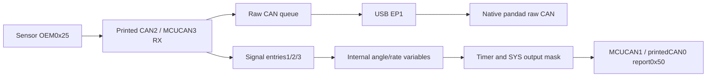

## November 8 — Temporary bitrate test explained (QA57)

Bitrate must match: sensor previously500k; matching nightly plus saved CAN2zero
predicts250k at boot, not measured current timing. Proposed temporary USB change
sets running CAN2to500k, then captures raw0x25; flash/firmware stay unchanged,
reboot reuses saved configuration. Explanation only; no new hardware action or
write authorization. QA56report remains source; existing holds and next step stay.

## 2026-11-08 correction — installed-image boot differs (QA56)

The matching signed nightly was now disassembled, with a fresh128-byte USB
signature match. It defaults all3rates to250kand reads nonzero SYS saved speeds;
zero retains250k. Current saved500/500/0predicts500/500/250k at boot. This changes
the installed-image interpretation of the preserved-source discussion below;
its fixed500k/ignored-fields findings are still source-only. Active registers/
RAM remain unread. See ../Reports/chimera-can-deep-audit-20261108/README.md and
focused-thumb.txt for exactaddresses, tests and proposed temporary rate test.
No writes applied; CAN2receive remains0and existing holds remain.

# Chimera SYS_CFG — source-backed deep study

November 8, 2026. Study baseline `2eff97d5c1c2badf068c84b90cfe172711b2a6fd`.
This explains the preserved original source and the last read flash snapshot.
The exact source for installed `v1.0.0-DEV-de193215-DEBUG` remains unrecovered;
source behavior below is not proof of that image's active RAM/register state.

## What SYS_CFG is

SYS_CFG is entry0 of Chimera's nonvolatile configuration block. The block begins
at source address0x08020000:4-byte magic,32entries of24bytes, then4-byte CRC32,
776bytes total. Magic is0xDEADBEEF; CRC covers the768entry bytes. Each entry has
23payload bytes and a final type byte. SYS type is1. Entries1..31are distinct
signal/module records, not additional SYS settings.

The last actual guarded read (QA50) obtained two identical CRC-valid blocks,
SHA256 `4b025b9e65b10475013ed39f8d4e66abf780a7cbe6ebf18833d952e46ffe3b22`.
SYS_CFG already exists. Its last read values are below; this task did not read
hardware again or change any value.

| Entry-relative bytes | Field | Last saved value | Preserved-source consumer |
| --- | --- | --- | --- |
| 0 | debug_lvl | 3 | bit0 enables selected debug logging |
| 1 | can_out_en | 15 /0x0F | bits1/2/4/8 enable generated reports below |
| 2 | iwdg_en | 0 | bit0 controls watchdog startup |
| 3 | mode in cfg_extra | 0 | Stored by UI/CLI; no Chimera app consumer found |
| 4–5 | override threshold, big-endian | 0 | Stored by UI/CLI; no Chimera app consumer found |
| 6–14 | other/reserved bytes | zeros | Preserve unknown fields |
| 15–22 | four uint16 little-endian saved speeds, kbit/s | 500,500,0,0 | UI fields; no startup reader in preserved source |
| 23 | record type | 1 | SYS type |

The desktop/API represents500kbit/s as5000; the stored uint16 is500. CAN3is a
fourth legacy storage slot, not a fourth physical Chimera bus. A shared tool's
mode0“Unconfigured” label does not establish disabled Chimera reception: the
selected Chimera application does not consume that mode byte.

## What the output mask means

| Mask bit | Generated message | Source output |
| --- | --- | --- |
| 0x01 | 0x50 steering-angle report | MCUCAN1 /printedCAN0 |
| 0x02 | 0x75 engine report | MCUCAN1 /printedCAN0 |
| 0x04 | 0x76 speed report | MCUCAN1 /printedCAN0 |
| 0x08 | 0x100 cruise/button report | MCUCAN1 /printedCAN0 |

0x0Fallows all four generated report families. These bits are not individual
CAN0/CAN1/CAN2receive-enable switches. send_can1_message writes MCUCAN1TX
mailboxes directly; it is not a USB delivery function or a qualified host route.
Host bus routing and command/safety admission remain separate contracts.

## How startup and Save differ

main() copies the flash block into local current_cfg_in_ram. It validates magic,
CRC, entry types and CAN-purpose/index agreement, then init_config_pointers
points at nonzero-type entries in that RAM copy. The selected source calls this
initializer at startup, not in its USB entry-write handler. Flash Read therefore
reads saved bytes, not the currently used RAM copy; Save alone does not prove
runtime adoption. The watchdog enable test also occurs during startup.

The USB0xFFpath reads flash.0xFEreplaces an entry by rewriting the whole776-byte
block in sector5, not just24bytes in isolation.0xFDformats allentriesempty.
The preserved source includes a later local watchdog-window/full-readback repair;
that repair is not proven installed in the historical nightly. Retain the real
October4erase incident/quarantine. This study authorizes no Save/Format/reset.

The original Python CLI SYS writer creates20zero extra bytes, then sets mode
and threshold. It does not preserve stored speed/reserved bytes. The website
SYS encoder preserves an existing24-byte record and changes selected fields.
Neither tool's USB success message proves active controller timing.

## Raw receiving and sensor translation are distinct

CAN3_RX0_IRQ_Handler applies enabled matching-ID sensor entries when present,
then calls can_rx(2). can_rx pushes raw mailboxes and USB EP1 drains that queue
without requiring SYS output bits or an angle mapping. Thus raw0x25should be
observable from a functioning physical receive path before translated-angle
configuration. No mapping/calibration can recover a frame that never arrives.

Entries1/2/3are steering major angle/fraction/rate. Their layout must match the
installed decoder; the desired OEM bit positions, sign/scale, state/checksum and
calibration must be qualified. The last snapshot has entries1..31allzero. That
means no saved sensor extraction records; it does not diagnose zero raw frames.
The separate sensor output report0x50must still match canonical RetroPilot DBC
and explicit routing. Do not relabel OEM0x25as0x50or change the shared DBC.

## Compatibility findings that affect any future configuration

- Preserved CAN entries: IDbytes0..3, int32offset4..7, int16multiplier8..9,
  length10, purpose11, shift12, bitlength13, endian14, enabled15, signed16,
  extra17..22, type23. The extractor builds a big-endian message and does not
  consult endian_type in the inspected function.
- Website CAN editor: ID0..3, float32scale4..7, float32offset8..11, length12,
  purpose13, shift14, bitlength15, endian16, enabled17, signed18, bus19,type23.
  The schemas differ; shared24-byte length does not establish compatibility.
- Selected legacy signal handler is hardwired to MCUCAN3; it does not read the
  website's CAN-bus byte from the extra bytes. Naming0/1/2versus1/2/3also needs care.
- Startup explicitly sets all3controllers500k. Saved SYS speeds/mode/override
  are not consumed by this selected app. Runtime0xDEonly changes bus0.
- Some timer/debug paths dereference signal pointers without a null check,
  despite the loader skipping empty entries. This is an audit finding in the
  preserved source, not a diagnosed installed-image fault or authorization to fix it.

## What we can conclude for this board

SYS_CFG is already present and generated-report mask0x0Fis saved. A separate
compatible sensor mapping is needed for translation, but changing SYS has not
been shown to fix the current zero raw CAN capture. SavedCAN2zero is a real
stored discrepancy; it is not active bitrate readback or measured low voltage.
The last known working Waveshare sensor setup, zero Chimera captures and unknown
CAN2electrical/timing state remain separate evidence. Keep sensor onCAN2as owner
selected. Do not automatically write config, reboot or resume halted firmware.

[Source pins and coverage](../Reports/chimera-syscfg-study-20261108/SOURCES.json),
[exact byte layout](../Reports/chimera-syscfg-study-20261108/LAYOUT.json) and
[actual website decoder result](../Reports/chimera-syscfg-study-20261108/SITE_DECODE.json).
Source locations: chimera_old/firmware/chimera/chimera.h20/250/302/334/360;
main.c172/343/519/569/600/776/1064/1134/1213; can.h302.

Used Understand Anything's explain workflow and focused existing teacher graph
only as a retrieval aid. Its topic graph has no commit pin and predates native
Chimera support; it is not a SYS_CFGsource graph or current runtime evidence.
Actual source review/byte decoding and compact Unlazy checks back this study.
REA source-first routing was read; no binary decompilation or exact-nightly
analysis was performed or claimed. No product/hardware/firmware/config change.

## Decimal bit flags and how to choose values — November 8 (QA54)

These fields hold bit flags. Each power of two selects one switch; combine
distinct selections with bitwiseOR (`|`). Adding distinct powers of two gives
the same result. They are not automatic verbosity levels or CAN voltages/speeds.

For Debug, both preserved Chimera consumers test only `debug_lvl & 1`:

| Decimal | Binary | Effect on these debug branches |
| --- | --- | --- |
| 0 | 00000000 | Off |
| 1 | 00000001 | On |
| 2 | 00000010 | Off; no value2consumer found |
| 3 | 00000011 | On, same observed logging as1 |
| 4 | 00000100 | Off; no value4consumer found |

Why the historical saved value was3is not recorded. Do not invent extra UART,
CAN or verbosity categories for bits2/4. This is preserved-source behavior, not
proof of the exact installed nightly's complete debug semantics.

Output mask uses value1for angle0x50,2for engine0x75,4for speed0x76and8for
cruise/buttons0x100. Thus1is angle only,3=1|2is angle+engine,5=1|4is
angle+speed,15=1|2|4|8=0x0Fis allfour.0disables these generated reports, not
raw CAN receiving or physical transceivers. Generated reports use MCUCAN1/
printedCAN0in this source; the mask does not select four physical CAN buses.

To express a desired setting, choose the Debug logging flag and combine the
wanted output flags. For example Debug1/output1describes logging and only the
angle-report family, subject to compatible sensor mappings and firmware. This
is an explanation, not an applied profile or calibrated sensor setup. Current
last-saved Debug3/output15already selects observed logging and allfourfamilies.

The current native Core Config desktop bridge is read-only and disables SYS
Write/Save; editing a displayed value cannot make it program the board. Any
future application needs the compatible guarded write path, a backup, preserving
other SYS fields and exact full-block readback. No Save/Format/reset/firmware or
settings change was performed. Historical write incident/quarantine stays.
[Truth table/source pins](../Reports/chimera-syscfg-study-20261108/BIT_FLAGS_FOLLOWUP.json).

## A transmitting device on any physical CAN bus — November 8 (QA55)

The selected source routes all three RX handlers through can_rx(0/1/2), the raw
queue and USB EP1. PrintedCAN0/1/2map MCUCAN1/2/3and hostUSB0/1/2respectively.
A correctly powered, actively transmitting classic CAN device should provide
raw IDs/data when bitrate, H/L/sharedground/termination/ACK, controller/filter
setup, transceiver supply/enable and USB reader are all functioning. Devices
that only answer requests can remain quiet; no active requests were sent here.

No sensor mapping or SYS output flag is required for this raw path in preserved
source. Angle degrees/translated reports require a compatible decoder/mapping.
This intended capability is not proof every connector works: actual latestCAN2
sensor tests still0, physical CAN0/CAN1comparison unperformed, owner keepsCAN2.
The llcan_init source also notes difficulties programming CAN2/CAN3filter
registers. Retain it as a controller/software lead, not diagnosed hardware or
installed firmware failure. No firmware change is authorized by this finding.
[Mapping and source pins](../Reports/chimera-syscfg-study-20261108/THREE_BUS_FOLLOWUP.json).
