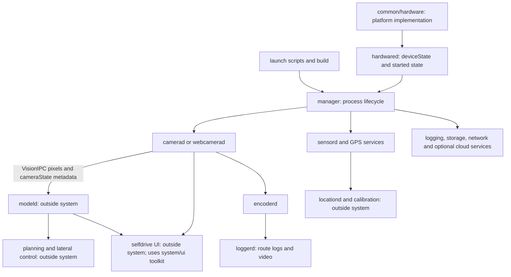

> Imported pinned review from `/home/radxa/comma/q8b/SUNNYPILOT_SYSTEM_REVIEW.md`.
> Findings and old validation remain tied to its recorded source; current workspace roles are in STATE.md.

# Sunnypilot system code and the Radxa Q8B port

Reviewed 2026-11-01 against upstream `6f7a2c94c10dffcf9a83b120ab1e6985e4496868`
(Sunnypilot 2026.003.000 / COMMA 0.11.3). This is a source explanation and port
map, not a completed or tested Radxa integration. The vendor copy remains clean.
Future implementation belongs in `q8b/sunnypilot-radxa`, branch `radxa/q8b`;
its reviewed HEAD is `824be91bbffed684bb91fb932e9cb7e509c76dc3`.

## What “system” means here

There are two different directories:

| Directory | What is actually there |
| --- | --- |
| `sunnypilot/system/` | Only the tracked compatibility symlink `hardware/tici/agnos.json`. It resolves through `openpilot/system/hardware/comma/agnos.json` to `openpilot/common/hardware/comma/agnos.json`. That manifest has seven comma boot/OS partition entries with downloads, hashes and A/B handling. |
| `sunnypilot/openpilot/system/` | The actual running services, camera and sensor drivers, device monitoring, logging, setup utilities and shared UI components. |

The second directory mixes hardware-specific code with reusable software. It
does not contain all hardware support. The Python/C++ platform abstraction is
in `openpilot/common/hardware/`; model execution is in `openpilot/selfdrive/modeld/`
and `openpilot/sunnypilot/modeld_v2/`; vehicle interfaces are elsewhere again.
Sensor register tables and the Chestnut firmware are hardware data, while most
files here are programs. Runtime routes, Params, models and persistent identity
use paths supplied by `openpilot/common/hardware/hw.py` and `hw.h`.

The open IDE file `.idea/customTargets.xml` defines CLion external SCons debug,
release and clean actions. It does not select or describe Q8B hardware.

## How the services fit together

This is a dependency map, not a claim that manager starts services in a strict
readiness order. Services establish their own connections. A working camera
preview alone does not prove localization, model messages or lateral control.

## The important code, function by function

### 1. Platform selection happens outside system

In [`common/hardware/__init__.py`](/home/radxa/comma/sunnypilot/openpilot/common/hardware/__init__.py),
`AGNOS = os.path.isfile('/AGNOS')`, `COMMA_HARDWARE = AGNOS` and `PC = not
COMMA_HARDWARE`. This chooses `HardwareComma` or `HardwarePc`. ARM64 by itself
does not select comma hardware. `HardwareComma` documents `tici` as comma three,
`tizi` as comma 3X and `mici` as comma four; its implementation is for the
Snapdragon 845 comma platform. Q8B is a different board/kernel environment.

`HardwarePc` returns `pc` and assumes Wi-Fi; many other methods inherit base
defaults or stubs. It is a development starting point, not real Q8B health
monitoring. Python selection and the C++ `__COMMA_HARDWARE__` build selection
must remain consistent. Do not create `/AGNOS` to force Q8B onto the comma path:
that selects board-specific GPIO, KGSL, power, modem and update behavior too.

**Radxa work:** provide an explicit Q8B platform boundary and measured sensor,
thermal, power and display behavior. How the new identity is represented in
cereal and camera lookup tables needs an explicit design; an invented `radxa`
string alone will not satisfy those contracts.

### 2. `manager/`: starts and supervises the application

- `manager.py:manager_init()` saves a boot log, clears lifecycle Params,
  installs defaults, records source/device versions and calls registration.
- `manager_thread()` reads `deviceState.started`, `carParams` and `pandaStates`;
  it clears transition-specific Params, calls `ensure_running()` and publishes
  `managerState`. `BLOCK` excludes named processes; `NOBOARD` excludes pandad.
  These development controls do not provide missing vehicle state.
- `manager_cleanup()` stops managed processes. `main()` handles exit and asks
  the selected hardware backend to uninstall, reboot or shut down when requested.
- `process.py` supplies Python, native and persistent-daemon wrappers.
  `launcher()` imports a module and calls its `main()`; `nativelauncher()` execs
  a binary. `ensure_running()` evaluates enable flags and run conditions.
  `stop()` signals, waits and escalates if necessary. Native/Python `start()`
  returns while a process handle already exists, even if the child has exited;
  `stop()` clears that handle. Do not assume every crashed child is immediately
  restarted while its run condition remains true. Q8B restart behavior needs
  explicit testing, including service-state transitions.
- `process_config.py` is the service list and the main platform switchboard.
  `USE_WEBCAM` selects Python webcamerad instead of the native camera service.
  Many sensor/GPS/update services are gated by PC/comma flags. The stock and
  Sunnypilot Tinygrad model services are selected by model-runner Params.
- `build.py` invokes SCons, retries with reduced parallelism and displays
  compiler output. `helpers.py` prevents blocked terminal output and starts the
  boot-log capture helper.

**Radxa work:** preserve lifecycle logic, define a bounded Q8B service profile,
and connect actual camera/model processes. Do not solve this by removing all
startup checks or pretending ignition is present. Initial recorded-input/UI
work can use isolated publishers before full manager startup.

### 3. `hardware/`: health, power and deciding when to go onroad

`hardwared.py` is more than a temperature reader:

- `hw_state_thread()` gathers slower network/modem/USB state.
- `hardware_thread()` initializes the hardware backend, reads thermal and
  system statistics, receives Panda/peripheral state and publishes `deviceState`.
- Startup conditions include ignition, temperature, free space, completed
  setup/training, accepted terms, device boot completion and update state.
  `deviceState.started` then drives manager's onroad/offroad process choices.
- The same loop manages power-save requests, shutdown decisions and Chestnut
  detection/status. `main()` adds comma-only touch and Chestnut-monitor threads.
- `fan_controller.py` uses a temperature feedback controller. Its setpoints
  are comma policy, not measured Q8B limits. This file computes desired fan
  percentage; it does not establish a Q8B fan driver.
- `power_monitoring.py` integrates offroad energy use, estimates car-battery
  capacity and requests shutdown based on elapsed time/voltage. Its electrical
  assumptions require review for our actual supply and interface.
- `chestnut/` handles the optional external GPU accessory, not Q8B's onboard
  Adreno. It contains USB/PCIe/power/temperature monitoring, alert state,
  a firmware image and its flashing tool. `Chestnut.update()` can invoke the
  flasher for a detected mismatched accessory; it is not just passive metadata.

**Radxa work:** supply genuine Q8B readings and supported power/fan operations;
retain meaningful health gates. Make accessory use explicit rather than
treating the Adreno as Chestnut. No firmware tool was executed in this review.

### 4. `camerad/`: real camera acquisition and publishing

The native flow is `main.cc` → `camerad_thread()` in `camera_qcom2.cc` →
`SpectraMaster` / `SpectraCamera` in `spectra.cc` → buffers and VisionIPC.

- `main.cc` pins the service to CPU 6 before entering camerad.
- `camera_qcom2.cc` opens configured cameras, runs exposure control, handles
  camera events and publishes frame metadata, including SOF/EOF times.
- `spectra.cc` implements the Qualcomm request-manager/ISP path: open devices,
  probe/configure sensors, map memory, submit requests, handle completion,
  synchronize frames and recover queues. It opens comma-specific V4L device
  paths. Qualcomm silicon in both boards does not guarantee this driver ABI.
- `camera_common.cc/.h` owns frame metadata/buffers, publishes VisionIPC and
  computes exposure statistics. `hw.h` describes camera roles, optics and ports.
- `cdm.*`, `ife.h` and `bps_blobs.h` describe low-level ISP command generation,
  packed configurations and generated BPS data. They are not USB camera settings.
- `sensors/ox03c10*` and `os04c10*` describe specific image sensors, exposure and
  large register initialization tables. They do not describe our USB OV4689
  capture path merely because the sensor vendors are related.
- `nv12_info.py/.h` calculate Qualcomm/Venus buffer padding. For 1280×720,
  Y height becomes 736 and UV begins at byte 942080 for stride 1280; tight
  NV12 begins UV at 921600. Identical width/height and the label NV12 are not
  enough to guarantee buffer compatibility.
- `snapshot.py` consumes camera streams for snapshots; it is not a driver.

The small Python webcam example is useful as a publishing reference:
`webcam/camera.py` requests 1280×720 at 25 FPS, decodes through OpenCV,
rotates 180° and converts BGR to NV12. `webcam/camerad.py` publishes at 20 Hz,
allocates buffers, and sends pixels plus camera-state messages. Its SOF/EOF
values are generated as `frame_id * 0.05 * 1e9`, not acquisition timestamps.
It advertises optional wide/cabin streams only when their variables are set.

**Radxa work:** adapt our existing measured V4L2/Adreno capture to the standard
VisionIPC + camera-state contract, preserving real timestamps, sequence IDs,
orientation, calibration, dimensions, color and buffer lifetime. A single
physical camera does not automatically satisfy every narrow/wide model input.
Neither a copied Python buffer nor a matching NV12 name proves zero-copy.

### 5. `sensord/`, `qcomgpsd/`, `ubloxd/`: motion and position

`sensord.py` constructs LSM6DS3 accelerometer, gyro and temperature devices on
I²C bus 1. It uses GPIO chip 0 line 84, specific interrupt-affinity paths,
IRQ timestamps and polling for temperature. The drivers configure registers,
check chip IDs, scale samples and publish standard sensor messages.
The accelerometer emits `[y, -x, z]` in m/s² and the gyro uses the same axis
permutation with rad/s scaling. These are mounting assumptions, not universal
Radxa axes.

`qcomgpsd` configures the Quectel/modem GNSS path and parses Qualcomm diagnostic
and NMEA data. `ubloxd` parses u-blox messages, navigation and ephemerides;
`pigeond.py` controls the receiver power/serial link and assistance data. Its
`/dev/ttyHS0` and GPIO setup are comma-specific. The parser can be reused when
the actual receiver protocol matches; the transport must match our hardware.

**Radxa work:** identify the real IMU/GNSS source, orientation, units, rates,
clock alignment and health reporting. For live lateral work, an image-only
model does not supply the missing physical gyro/accel measurements. No Q8B
IMU/GNSS compatibility was established by reading these drivers.

### 6. `loggerd/`: records messages, video and operational evidence

`loggerd.cc` records subscribed cereal messages and coordinates route segments.
`logger.cc/.h` handle route metadata and log files; `zstd_writer.*` compress
logs. `encoderd.cc` consumes camera VisionIPC and publishes encoded video with
frame IDs/timestamps; `video_writer.*` write/mux video and audio. `bootlog.cc`
captures startup evidence. `config.py` defines 20 FPS, 60-second segments and
storage helpers.

`SConscript` chooses the comma V4L encoder/decoder and clip support only for
`comma_arm64`; other targets build `ffmpeg_encoder.cc`. The PC path currently
selects H.264 for QCAMERA_H264 and FFVHUFF for other types, so “PC recording”
must not be assumed to have the same size/acceleration as comma HEVC recording.
`jpeg_encoder.*` supply JPEG encoding; `clip_encoder.*` transcode selected
recorded HEVC segments using the comma V4L path.

`deleter.py` deletes old routes under low-space conditions, retaining recent
preserved segments preferentially; `uploader.py` queues/uploads logs according
to network and Params. `xattr_cache.py` caches upload/preservation attributes.

**Radxa work:** keep message logging; verify paths, disk budget, frame pairing
and recording CPU load. Qualify any hardware encoding separately. Cloud upload
is not needed to prove the first local camera/model/UI slice.

### 7. `ui/`: shared graphics and setup tools

This checkout uses Python raylib/pyray, not the old Qt onroad UI. `lib/application.py`
owns the window, fonts, input, scaling and render loop. `lib/egl.py` wraps
EGL DMA-BUF/NV12 image import. `widgets/` contains reusable controls.
`ui/sunnypilot/` extends those controls with Sunny settings/model-download/
pairing components. The actual driving screen is in `openpilot/selfdrive/ui/`.

The README's `BIG=1` selects the larger comma 3X-style UI; comma four-style
layout is the default. This is a layout choice, not a hardware port.
`setup.py`, `reset.py` and `updater.py` dispatch to the tici/mici layout variants.
Those utilities contain comma installation/reset/OS-update flows, which are
different from rendering the driving screen. Wi-Fi code uses NetworkManager
over D-Bus; cellular code depends on the platform SIM/LPA/modem interfaces.

**Radxa work:** initially retain widgets and qualify display/input/OpenGL and
camera texture rendering on our Linux desktop. EGL import requires an actual
compatible buffer/export path. Do not reuse comma erase/install/OS-flash flows
as the Radxa installer. Keep the host network stack explicit.

### 8. Cloud, updates and the small service files

| Code | What it does | Radxa treatment |
| --- | --- | --- |
| `athena/registration.py` | Loads device identity/keys or attempts registration; missing keys select unregistered identity. | Use an explicit local development/identity policy. No cloud-account assumption. |
| `athena/manage_athenad.py`, `athenad.py`, `rpc.py` | Maintain the remote connection, dispatch RPC, upload/proxy/log/stream requests. | Optional to the first local milestone; do not confuse with Sunny's separate sunnylink implementation. |
| `updated/updated.py` | Fetches into a staging overlay, prepares replacement source and can stage AGNOS updates. | Separate from our maintenance timer. Keep disabled/excluded from protected-port updating until a reviewed policy exists; generic PC manager already excludes it. |
| `webrtc/` | Session/signaling server, message proxies, adaptive stream bitrate and encoded-video tracks. | Optional; requires working encoded camera messages. |
| `logmessaged.py` | Collects process logs over ZeroMQ, writes files, publishes log/error messages. | Reuse after dependencies and paths are built. |
| `journald.py` | Publishes `journalctl` OS logs. | Reuse if journal access is available. |
| `proclogd.py` | Publishes CPU, memory and process statistics from Linux `/proc`. | Reuse; verify permissions and overhead. |
| `micd.py` | Reads audio, publishes raw audio and weighted sound-pressure estimates. | Select/qualify the actual microphone; it is not the speaker warning service. |
| `timed.py` | Publishes clocks and may set wall time from GPS. | Coordinate with Linux time synchronization; preserve monotonic frame time. |
| `tombstoned.py` | Collects/reports native crashes using comma tombstone/apport paths. | Adapt to the host's actual crash collection. |

The existing daily controller at `q8b/sunnypilot-maintenance` updates only the
clean vendor clone, records commits and queues discussion. It never merges
upstream into the protected Radxa port. Sunnypilot's own `updated` service is
not that controller and must not bypass this protection.

## Order of the Radxa work

1. **Pin the new stock contracts:** source, schemas, model, parser and runtime.
   The preserved Q8B model/runtime are separate references; old benchmark
   results do not validate the new stock model. Build required message/buffer
   extensions in the protected clone.
2. **Recorded camera → model messages → real Sunny UI:** implement the camera
   and runtime adapter boundaries with deterministic fixtures and frame pairing.
   The current stock build selects CPU:LLVM on non-comma Linux, and Sunny's
   modeld_v2 explicitly chooses CPU when `COMMA_HARDWARE` is false. `USE_WEBCAM`
   or `DEV=QCOM` alone does not connect our patched MSM/Adreno backend.
3. **Live camera and real hardware health:** integrate capture lifetime,
   timestamps, Q8B thermal/power behavior and actual IMU/GNSS where required.
4. **Manager ownership and fault recovery:** qualify startup, stale data,
   restart, shutdown, logging and display behavior together.
5. **Separate vehicle/lateral milestone:** integrate measured vehicle state,
   the custom steering interface, feedback and safety under the canonical
   RetroPilot DBC policy. Those changes span car/controls/firmware code outside
   system; this review does not authorize or validate vehicle actuation.

We should preserve the shared driving software and adapt the specific hardware
boundaries, rather than replace every file in system. The file catalog below
records the complete source scope for that decision.

## Review coverage and evidence

All **193 tracked paths** across both system roots were inventoried and hashed:
**32,522 regular text lines**, three compatibility symlinks and one binary
firmware image. All **139 Python files** were parsed
without importing them. Core lifecycle/hardware/camera/sensor/build bodies
and selected logging/UI/cloud/update paths were inspected; supporting files
were classified using declarations, source excerpts and their callers.

This is a complete file catalog, not an assertion that every line, sensor
register, generated ISP byte, firmware instruction or test assertion was
individually validated. Upstream test files are identified, not claimed passed.
No manager, camera, model, flasher, network RPC, CAN or vehicle service ran.
No source changes were made in either vendor or protected clone.

Evidence: [inventory and symbols](/home/radxa/comma/Ai/Reports/sunnypilot-system-review-20261101/source-inventory.json),
[verification](/home/radxa/comma/Ai/Reports/sunnypilot-system-review-20261101/verification.json).
Local source links below point to the vendor checkout and can advance with
its daily update; the inventory hashes and commit above pin this review.

## Every tracked file

The catalog is generated from Git's tracked tree, including hidden test files.
Each row explains the file's role and the expected port treatment. Treatment
is proposed source scope, not a completed change or proof of compatibility.

### __init__.py
| File | Purpose | Radxa treatment |
| --- | --- | --- |
| [__init__.py](/home/radxa/comma/sunnypilot/openpilot/system/__init__.py) (0 lines) | Empty Python package marker. | Retain package structure |

### athena
| File | Purpose | Radxa treatment |
| --- | --- | --- |
| [athena/__init__.py](/home/radxa/comma/sunnypilot/openpilot/system/athena/__init__.py) (0 lines) | Empty Python package marker. | Retain package structure |
| [athena/athenad.py](/home/radxa/comma/sunnypilot/openpilot/system/athena/athenad.py) (1195 lines) | Remote websocket client: JSON-RPC, upload queues, proxying, navigation requests, log/stat and stream support. | Optional local milestone |
| [athena/manage_athenad.py](/home/radxa/comma/sunnypilot/openpilot/system/athena/manage_athenad.py) (46 lines) | Supervisor for the persistent remote client, including retries and connection-state Params. | Optional local milestone |
| [athena/registration.py](/home/radxa/comma/sunnypilot/openpilot/system/athena/registration.py) (108 lines) | Reads persistent identity and keys; handles unregistered status or server registration. | Review identity policy |
| [athena/rpc.py](/home/radxa/comma/sunnypilot/openpilot/system/athena/rpc.py) (116 lines) | JSON-RPC serialization, error objects and method dispatcher used by Athena. | Reuse protocol helper |
| [athena/tests/__init__.py](/home/radxa/comma/sunnypilot/openpilot/system/athena/tests/__init__.py) (0 lines) | Empty Python package marker. | Retain package structure |
| [athena/tests/helpers.py](/home/radxa/comma/sunnypilot/openpilot/system/athena/tests/helpers.py) (69 lines) | Remote-client test mocks and fixtures. | Test/reference only; not executed |
| [athena/tests/test_athenad.py](/home/radxa/comma/sunnypilot/openpilot/system/athena/tests/test_athenad.py) (522 lines) | Remote RPC, upload and connection behavior tests. | Test/reference only; not executed |
| [athena/tests/test_athenad_ping.py](/home/radxa/comma/sunnypilot/openpilot/system/athena/tests/test_athenad_ping.py) (102 lines) | Remote connection/ping behavior tests. | Test/reference only; not executed |
| [athena/tests/test_registration.py](/home/radxa/comma/sunnypilot/openpilot/system/athena/tests/test_registration.py) (77 lines) | Identity registration path tests. | Test/reference only; not executed |

### camerad
| File | Purpose | Radxa treatment |
| --- | --- | --- |
| [camerad/SConscript](/home/radxa/comma/sunnypilot/openpilot/system/camerad/SConscript) (8 lines) | Builds native camera service from Qualcomm camera, ISP and image-sensor sources on non-Darwin targets. | Adapt build/provider choice |
| [camerad/__init__.py](/home/radxa/comma/sunnypilot/openpilot/system/camerad/__init__.py) (0 lines) | Empty Python package marker. | Retain package structure |
| [camerad/cameras/bps_blobs.h](/home/radxa/comma/sunnypilot/openpilot/system/camerad/cameras/bps_blobs.h) (30 lines) | Generated BPS ISP configuration byte arrays, including large packed data tables. | Keep as comma reference |
| [camerad/cameras/camera_common.cc](/home/radxa/comma/sunnypilot/openpilot/system/camerad/cameras/camera_common.cc) (109 lines) | CameraBuf allocation, VisionIPC frame publication, raw-frame extraction and exposure measurement; V4L device lookup. | Reuse contracts; review layout |
| [camerad/cameras/camera_common.h](/home/radxa/comma/sunnypilot/openpilot/system/camerad/cameras/camera_common.h) (46 lines) | CameraBuf and FrameMetadata declarations, buffer count and shared camera helper API. | Reuse contracts; review ownership |
| [camerad/cameras/camera_qcom2.cc](/home/radxa/comma/sunnypilot/openpilot/system/camerad/cameras/camera_qcom2.cc) (309 lines) | CameraState initialization/exposure control, frame-state publication and native event loop. | Replace/adapt acquisition boundary |
| [camerad/cameras/cdm.cc](/home/radxa/comma/sunnypilot/openpilot/system/camerad/cameras/cdm.cc) (47 lines) | Encodes ISP register/DMI command buffers for Qualcomm CDM. | Keep as comma reference |
| [camerad/cameras/cdm.h](/home/radxa/comma/sunnypilot/openpilot/system/camerad/cameras/cdm.h) (79 lines) | Packed CDM command formats, opcodes and encoder declarations. | Keep as comma reference |
| [camerad/cameras/hw.h](/home/radxa/comma/sunnypilot/openpilot/system/camerad/cameras/hw.h) (73 lines) | Camera role/stream, focal length, PHY, processing and synchronization configurations. | Provide actual Q8B geometry |
| [camerad/cameras/ife.h](/home/radxa/comma/sunnypilot/openpilot/system/camerad/cameras/ife.h) (236 lines) | Packed Qualcomm IFE register/configuration structures. | Keep as comma reference |
| [camerad/cameras/nv12_info.h](/home/radxa/comma/sunnypilot/openpilot/system/camerad/cameras/nv12_info.h) (130 lines) | C++ NV12 stride, plane-height and allocation padding calculations. | Verify consumer buffer agreement |
| [camerad/cameras/nv12_info.py](/home/radxa/comma/sunnypilot/openpilot/system/camerad/cameras/nv12_info.py) (21 lines) | Python counterpart of Qualcomm/Venus NV12 layout calculations. | Verify consumer buffer agreement |
| [camerad/cameras/spectra.cc](/home/radxa/comma/sunnypilot/openpilot/system/camerad/cameras/spectra.cc) (1578 lines) | Qualcomm sensor/ISP/request-manager setup, memory mapping, request queues, completion and recovery. | Replace/adapt driver boundary |
| [camerad/cameras/spectra.h](/home/radxa/comma/sunnypilot/openpilot/system/camerad/cameras/spectra.h) (245 lines) | SpectraMaster, SpectraCamera and MemoryManager state and driver APIs. | Keep as comma reference |
| [camerad/main.cc](/home/radxa/comma/sunnypilot/openpilot/system/camerad/main.cc) (15 lines) | Native entry point: CPU affinity and camerad_thread. | Adapt affinity/provider |
| [camerad/sensors/os04c10.cc](/home/radxa/comma/sunnypilot/openpilot/system/camerad/sensors/os04c10.cc) (135 lines) | OS04C10 dimensions, gains, exposure registers and ISP/color tuning. | Keep as sensor reference |
| [camerad/sensors/os04c10_registers.h](/home/radxa/comma/sunnypilot/openpilot/system/camerad/sensors/os04c10_registers.h) (332 lines) | OS04C10 sensor start and initialization register tables. | Keep as sensor reference |
| [camerad/sensors/ox03c10.cc](/home/radxa/comma/sunnypilot/openpilot/system/camerad/sensors/ox03c10.cc) (142 lines) | OX03C10 dimensions, HDR/gain/exposure and ISP/color tuning. | Keep as sensor reference |
| [camerad/sensors/ox03c10_registers.h](/home/radxa/comma/sunnypilot/openpilot/system/camerad/sensors/ox03c10_registers.h) (751 lines) | OX03C10 sensor start and initialization register tables. | Keep as sensor reference |
| [camerad/sensors/sensor.h](/home/radxa/comma/sunnypilot/openpilot/system/camerad/sensors/sensor.h) (104 lines) | SensorInfo optics, dimensions, register/exposure interface and OX03C10/OS04C10 declarations. | Use actual selected camera contract |
| [camerad/snapshot.py](/home/radxa/comma/sunnypilot/openpilot/system/camerad/snapshot.py) (68 lines) | Subscribes to VisionIPC camera streams and converts snapshots to RGB. | Reuse after stream qualification |
| [camerad/test/.gitignore](/home/radxa/comma/sunnypilot/openpilot/system/camerad/test/.gitignore) (2 lines) | Ignores camera-debug outputs. | Test/reference only; not executed |
| [camerad/test/debug.sh](/home/radxa/comma/sunnypilot/openpilot/system/camerad/test/debug.sh) (16 lines) | Builds/runs camera debugging and changes kernel camera debug state. | Test/reference only; not executed |
| [camerad/test/icp_debug.sh](/home/radxa/comma/sunnypilot/openpilot/system/camerad/test/icp_debug.sh) (13 lines) | Enables Qualcomm ICP/camera kernel tracing and reads trace_pipe. | Test/reference only; not executed |
| [camerad/test/intercept.sh](/home/radxa/comma/sunnypilot/openpilot/system/camerad/test/intercept.sh) (2 lines) | Runs camerad with a comma-specific LD_PRELOAD ioctl interceptor. | Test/reference only; not executed |
| [camerad/test/stress_restart.sh](/home/radxa/comma/sunnypilot/openpilot/system/camerad/test/stress_restart.sh) (9 lines) | Repeatedly starts/stops the native camera service. | Test/reference only; not executed |
| [camerad/test/test_camerad.py](/home/radxa/comma/sunnypilot/openpilot/system/camerad/test/test_camerad.py) (167 lines) | Hardware camera stream, timing/exposure and restart-related tests. | Test/reference only; not executed |
| [camerad/webcam/README.md](/home/radxa/comma/sunnypilot/openpilot/system/camerad/webcam/README.md) (24 lines) | Documents generic PC webcam setup and camera environment variables. | Reference; not Q8B validation |
| [camerad/webcam/camera.py](/home/radxa/comma/sunnypilot/openpilot/system/camerad/webcam/camera.py) (39 lines) | OpenCV camera wrapper: requested 720p25, unconditional 180-degree flip, BGR-to-NV12 conversion. | Adapt to measured capture |
| [camerad/webcam/camerad.py](/home/radxa/comma/sunnypilot/openpilot/system/camerad/webcam/camerad.py) (79 lines) | Python VisionIPC/cameraState publisher: optional streams, threaded 20Hz loops and generated frame times. | Adapt timestamps/layout/lifecycle |

### hardware
| File | Purpose | Radxa treatment |
| --- | --- | --- |
| [hardware/chestnut/firmware_wrapped.bin](/home/radxa/comma/sunnypilot/openpilot/system/hardware/chestnut/firmware_wrapped.bin) (9235 bytes) | Bundled wrapped binary firmware for the optional Chestnut accessory. | Accessory only; not executed |
| [hardware/chestnut/flash.py](/home/radxa/comma/sunnypilot/openpilot/system/hardware/chestnut/flash.py) (581 lines) | Accessory firmware validation, USB bootloader transfers, programming/recovery and activation. | Accessory only; not executed |
| [hardware/chestnut/monitoring.py](/home/radxa/comma/sunnypilot/openpilot/system/hardware/chestnut/monitoring.py) (53 lines) | USB power/link reads merged with GPU telemetry and published as chestnutState. | Accessory only |
| [hardware/chestnut/status.py](/home/radxa/comma/sunnypilot/openpilot/system/hardware/chestnut/status.py) (107 lines) | Tracks accessory presence, model loading, power/link faults, temperatures and offroad alerts. | Accessory only |
| [hardware/comma/agnos.json](/home/radxa/comma/sunnypilot/openpilot/system/hardware/comma/agnos.json) (41 bytes) | Compatibility symlink to common/hardware/comma/agnos.json, the actual comma OS update manifest. | Comma OS manifest alias |
| [hardware/fan_controller.py](/home/radxa/comma/sunnypilot/openpilot/system/hardware/fan_controller.py) (28 lines) | Temperature feedback controller producing a desired fan percentage. | Retune/qualify Q8B policy |
| [hardware/hardwared.py](/home/radxa/comma/sunnypilot/openpilot/system/hardware/hardwared.py) (559 lines) | Device health/state publisher, startup/onroad gates, power policy and accessory handling. | Adapt platform reads and gates |
| [hardware/power_monitoring.py](/home/radxa/comma/sunnypilot/openpilot/system/hardware/power_monitoring.py) (133 lines) | Integrates battery energy, tracks capacity/voltage and decides offroad shutdown. | Adapt electrical policy |
| [hardware/tests/__init__.py](/home/radxa/comma/sunnypilot/openpilot/system/hardware/tests/__init__.py) (0 lines) | Empty Python package marker. | Retain package structure |
| [hardware/tests/test_fan_controller.py](/home/radxa/comma/sunnypilot/openpilot/system/hardware/tests/test_fan_controller.py) (47 lines) | Fan control response tests. | Test/reference only; not executed |
| [hardware/tests/test_power_monitoring.py](/home/radxa/comma/sunnypilot/openpilot/system/hardware/tests/test_power_monitoring.py) (231 lines) | Power integration, battery capacity and shutdown-condition tests. | Test/reference only; not executed |
| [hardware/tici/agnos.json](/home/radxa/comma/sunnypilot/openpilot/system/hardware/tici/agnos.json) (19 bytes) | Compatibility symlink through ../comma/agnos.json to the shared comma OS update manifest. | Comma OS manifest alias |

### journald.py
| File | Purpose | Radxa treatment |
| --- | --- | --- |
| [journald.py](/home/radxa/comma/sunnypilot/openpilot/system/journald.py) (43 lines) | Runs journalctl, decodes JSON journal entries and publishes operatingSystemLog. | Reuse with host permissions |

### loggerd
| File | Purpose | Radxa treatment |
| --- | --- | --- |
| [loggerd/.gitignore](/home/radxa/comma/sunnypilot/openpilot/system/loggerd/.gitignore) (4 lines) | Ignores generated logger/encoder/bootlog executables and test output. | Retain build-output rules |
| [loggerd/SConscript](/home/radxa/comma/sunnypilot/openpilot/system/loggerd/SConscript) (19 lines) | Builds logging/encoding programs; selects comma V4L or PC FFmpeg backend. | Review encoding target |
| [loggerd/__init__.py](/home/radxa/comma/sunnypilot/openpilot/system/loggerd/__init__.py) (0 lines) | Empty Python package marker. | Retain package structure |
| [loggerd/bootlog.cc](/home/radxa/comma/sunnypilot/openpilot/system/loggerd/bootlog.cc) (68 lines) | Creates startup log containing boot/build/system evidence and a Params snapshot. | Review host metadata/paths |
| [loggerd/clip_encoder.cc](/home/radxa/comma/sunnypilot/openpilot/system/loggerd/clip_encoder.cc) (290 lines) | Transcodes selected consecutive recorded HEVC segments using V4L decoding/encoding. | Comma-only build; defer/adapt |
| [loggerd/clip_encoder.h](/home/radxa/comma/sunnypilot/openpilot/system/loggerd/clip_encoder.h) (10 lines) | encode_clip interface for selection, duration, bitrate, speed and metadata. | Defer with clip backend |
| [loggerd/config.py](/home/radxa/comma/sunnypilot/openpilot/system/loggerd/config.py) (34 lines) | Camera FPS/segment duration, stats configuration and available-storage helpers. | Review storage budget |
| [loggerd/deleter.py](/home/radxa/comma/sunnypilot/openpilot/system/loggerd/deleter.py) (143 lines) | Low-space route cleanup with lock avoidance and preferential preservation handling. | Reuse after directory policy |
| [loggerd/encoder/encoder.cc](/home/radxa/comma/sunnypilot/openpilot/system/loggerd/encoder/encoder.cc) (42 lines) | Common encoded-frame publication with frame/segment indices and timestamps. | Reuse message contract |
| [loggerd/encoder/encoder.h](/home/radxa/comma/sunnypilot/openpilot/system/loggerd/encoder/encoder.h) (44 lines) | VideoEncoder abstraction: open/close, encode, bitrate/keyframe and publishing. | Reuse interface |
| [loggerd/encoder/ffmpeg_encoder.cc](/home/radxa/comma/sunnypilot/openpilot/system/loggerd/encoder/ffmpeg_encoder.cc) (156 lines) | PC encoder: converts/resizes input and encodes using FFmpeg codecs. | Qualify CPU/storage cost |
| [loggerd/encoder/ffmpeg_encoder.h](/home/radxa/comma/sunnypilot/openpilot/system/loggerd/encoder/ffmpeg_encoder.h) (36 lines) | FFmpeg encoder state and method declarations. | Reuse with chosen backend |
| [loggerd/encoder/jpeg_encoder.cc](/home/radxa/comma/sunnypilot/openpilot/system/loggerd/encoder/jpeg_encoder.cc) (115 lines) | JPEG encoding from camera buffer input. | Reuse after layout validation |
| [loggerd/encoder/jpeg_encoder.h](/home/radxa/comma/sunnypilot/openpilot/system/loggerd/encoder/jpeg_encoder.h) (35 lines) | JPEG encoder declaration. | Reuse after layout validation |
| [loggerd/encoder/v4l_decoder.cc](/home/radxa/comma/sunnypilot/openpilot/system/loggerd/encoder/v4l_decoder.cc) (393 lines) | Qualcomm V4L hardware decoder, buffer queues and decoded frames for clips. | Qualify driver ABI separately |
| [loggerd/encoder/v4l_decoder.h](/home/radxa/comma/sunnypilot/openpilot/system/loggerd/encoder/v4l_decoder.h) (105 lines) | Decoder interface/state and Qualcomm VIDC control constants. | Qualify driver ABI separately |
| [loggerd/encoder/v4l_encoder.cc](/home/radxa/comma/sunnypilot/openpilot/system/loggerd/encoder/v4l_encoder.cc) (392 lines) | Qualcomm V4L encoder configuration, input/output queues and encoded packet handling. | Qualify driver ABI separately |
| [loggerd/encoder/v4l_encoder.h](/home/radxa/comma/sunnypilot/openpilot/system/loggerd/encoder/v4l_encoder.h) (49 lines) | V4L encoder methods, configuration and queue state. | Qualify driver ABI separately |
| [loggerd/encoderd.cc](/home/radxa/comma/sunnypilot/openpilot/system/loggerd/encoderd.cc) (230 lines) | Connects camera VisionIPC streams to encoders; recording versus livestream behavior. | Reuse orchestration; qualify backend |
| [loggerd/logger.cc](/home/radxa/comma/sunnypilot/openpilot/system/loggerd/logger.cc) (203 lines) | Route initialization, init metadata and compressed log writing/rotation primitives. | Reuse after paths/metadata review |
| [loggerd/logger.h](/home/radxa/comma/sunnypilot/openpilot/system/loggerd/logger.h) (37 lines) | Logger state and initialization/rotation/write declarations. | Reuse interface |
| [loggerd/loggerd.cc](/home/radxa/comma/sunnypilot/openpilot/system/loggerd/loggerd.cc) (358 lines) | Main event recorder: subscribes services, handles encoded data/audio and rotates segments. | Reuse after integrated verification |
| [loggerd/loggerd.h](/home/radxa/comma/sunnypilot/openpilot/system/loggerd/loggerd.h) (199 lines) | Camera/encoder configuration, codec settings and common logging definitions. | Review camera/codec choices |
| [loggerd/tests/__init__.py](/home/radxa/comma/sunnypilot/openpilot/system/loggerd/tests/__init__.py) (0 lines) | Empty Python package marker. | Retain package structure |
| [loggerd/tests/loggerd_tests_common.py](/home/radxa/comma/sunnypilot/openpilot/system/loggerd/tests/loggerd_tests_common.py) (91 lines) | Camera/encoding/logging test fixtures and shared helpers. | Test/reference only; not executed |
| [loggerd/tests/test_deleter.py](/home/radxa/comma/sunnypilot/openpilot/system/loggerd/tests/test_deleter.py) (80 lines) | Route cleanup ordering, storage and preservation tests. | Test/reference only; not executed |
| [loggerd/tests/test_encoder.py](/home/radxa/comma/sunnypilot/openpilot/system/loggerd/tests/test_encoder.py) (153 lines) | Video encoder output/integration tests. | Test/reference only; not executed |
| [loggerd/tests/test_loggerd.py](/home/radxa/comma/sunnypilot/openpilot/system/loggerd/tests/test_loggerd.py) (341 lines) | Route recording, segment rotation and logging integration tests. | Test/reference only; not executed |
| [loggerd/tests/test_uploader.py](/home/radxa/comma/sunnypilot/openpilot/system/loggerd/tests/test_uploader.py) (181 lines) | Upload ordering, filtering and status tests. | Test/reference only; not executed |
| [loggerd/tests/vidc_debug.sh](/home/radxa/comma/sunnypilot/openpilot/system/loggerd/tests/vidc_debug.sh) (13 lines) | Enables Qualcomm video-codec kernel debug/tracing. | Test/reference only; not executed |
| [loggerd/uploader.py](/home/radxa/comma/sunnypilot/openpilot/system/loggerd/uploader.py) (271 lines) | Upload queue ordering, network/metered decisions, upload requests and status. | Optional local milestone |
| [loggerd/video_writer.cc](/home/radxa/comma/sunnypilot/openpilot/system/loggerd/video_writer.cc) (242 lines) | Video container/remux writing, metadata and audio encoding/muxing. | Reuse; qualify codec behavior |
| [loggerd/video_writer.h](/home/radxa/comma/sunnypilot/openpilot/system/loggerd/video_writer.h) (43 lines) | VideoWriter interface and FFmpeg/audio state. | Reuse interface |
| [loggerd/xattr_cache.py](/home/radxa/comma/sunnypilot/openpilot/system/loggerd/xattr_cache.py) (70 lines) | Cached extended-attribute reads/writes for upload/preservation markers. | Verify filesystem xattr support |
| [loggerd/zstd_writer.cc](/home/radxa/comma/sunnypilot/openpilot/system/loggerd/zstd_writer.cc) (65 lines) | Streaming compressed log-file writes. | Reuse |
| [loggerd/zstd_writer.h](/home/radxa/comma/sunnypilot/openpilot/system/loggerd/zstd_writer.h) (24 lines) | ZstdFileWriter interface and compression state. | Reuse |

### logmessaged.py
| File | Purpose | Radxa treatment |
| --- | --- | --- |
| [logmessaged.py](/home/radxa/comma/sunnypilot/openpilot/system/logmessaged.py) (55 lines) | Collects ZeroMQ process logs, writes rolling files and publishes log/error messages. | Reuse after dependencies/paths |

### manager
| File | Purpose | Radxa treatment |
| --- | --- | --- |
| [manager/__init__.py](/home/radxa/comma/sunnypilot/openpilot/system/manager/__init__.py) (0 lines) | Empty Python package marker. | Retain package structure |
| [manager/build.py](/home/radxa/comma/sunnypilot/openpilot/system/manager/build.py) (67 lines) | SCons build with progress display, power-save change and reduced-parallelism retries. | Review host build/affinity |
| [manager/helpers.py](/home/radxa/comma/sunnypilot/openpilot/system/manager/helpers.py) (61 lines) | PTY/nonblocking terminal forwarding and asynchronous bootlog capture. | Reuse after paths/build |
| [manager/manager.py](/home/radxa/comma/sunnypilot/openpilot/system/manager/manager.py) (246 lines) | Initialize defaults/identity, supervise run conditions and handle application shutdown. | Adapt service profile; retain lifecycle |
| [manager/process.py](/home/radxa/comma/sunnypilot/openpilot/system/manager/process.py) (238 lines) | Python/native/persistent process wrappers, stop/signals and ensure_running selection. | Reuse; test restart semantics |
| [manager/process_config.py](/home/radxa/comma/sunnypilot/openpilot/system/manager/process_config.py) (205 lines) | Service registry and onroad/offroad, hardware, webcam and model-runner predicates. | Primary Q8B service integration point |
| [manager/test/__init__.py](/home/radxa/comma/sunnypilot/openpilot/system/manager/test/__init__.py) (0 lines) | Empty Python package marker. | Retain package structure |
| [manager/test/test_manager.py](/home/radxa/comma/sunnypilot/openpilot/system/manager/test/test_manager.py) (84 lines) | Manager initialization/process behavior tests. | Test/reference only; not executed |

### micd.py
| File | Purpose | Radxa treatment |
| --- | --- | --- |
| [micd.py](/home/radxa/comma/sunnypilot/openpilot/system/micd.py) (129 lines) | Captures microphone audio and computes/publishes weighted sound pressure and raw audio. | Qualify actual audio device |

### proclogd.py
| File | Purpose | Radxa treatment |
| --- | --- | --- |
| [proclogd.py](/home/radxa/comma/sunnypilot/openpilot/system/proclogd.py) (286 lines) | Reads Linux /proc CPU/memory/process data and publishes procLog. | Reuse with host permissions |

### qcomgpsd
| File | Purpose | Radxa treatment |
| --- | --- | --- |
| [qcomgpsd/modemdiag.py](/home/radxa/comma/sunnypilot/openpilot/system/qcomgpsd/modemdiag.py) (116 lines) | Serial Qualcomm diagnostic framing with CRC/HDLC and log setup. | Only matching modem; adapt transport |
| [qcomgpsd/nmeaport.py](/home/radxa/comma/sunnypilot/openpilot/system/qcomgpsd/nmeaport.py) (171 lines) | GNSS clock/measurement NMEA parsing and serial-port processing. | Only matching receiver protocol |
| [qcomgpsd/qcomgpsd.py](/home/radxa/comma/sunnypilot/openpilot/system/qcomgpsd/qcomgpsd.py) (414 lines) | Quectel/modem GNSS initialization, diagnostic records and GPS publication. | Replace/adapt actual GNSS provider |
| [qcomgpsd/structs.py](/home/radxa/comma/sunnypilot/openpilot/system/qcomgpsd/structs.py) (353 lines) | Qualcomm GNSS diagnostic structure definitions and unpack helpers. | Protocol reference |

### sensord
| File | Purpose | Radxa treatment |
| --- | --- | --- |
| [sensord/__init__.py](/home/radxa/comma/sunnypilot/openpilot/system/sensord/__init__.py) (0 lines) | Empty Python package marker. | Retain package structure |
| [sensord/sensord.py](/home/radxa/comma/sunnypilot/openpilot/system/sensord/sensord.py) (148 lines) | IMU initialization, GPIO interrupt timestamping, temperature polling and sensor publication. | Adapt IMU/bus/IRQ/orientation |
| [sensord/sensors/__init__.py](/home/radxa/comma/sunnypilot/openpilot/system/sensord/sensors/__init__.py) (0 lines) | Empty Python package marker. | Retain package structure |
| [sensord/sensors/i2c_sensor.py](/home/radxa/comma/sunnypilot/openpilot/system/sensord/sensors/i2c_sensor.py) (78 lines) | I2C Sensor abstraction, register access, chip checks and integer decoding. | Reuse only for suitable device |
| [sensord/sensors/lsm6ds3_accel.py](/home/radxa/comma/sunnypilot/openpilot/system/sensord/sensors/lsm6ds3_accel.py) (157 lines) | LSM6DS3 accelerometer setup, self-test and scaled/remapped acceleration events. | Actual IMU compatibility required |
| [sensord/sensors/lsm6ds3_gyro.py](/home/radxa/comma/sunnypilot/openpilot/system/sensord/sensors/lsm6ds3_gyro.py) (141 lines) | LSM6DS3 gyro setup, self-test and scaled/remapped angular-rate events. | Actual IMU compatibility required |
| [sensord/sensors/lsm6ds3_temp.py](/home/radxa/comma/sunnypilot/openpilot/system/sensord/sensors/lsm6ds3_temp.py) (32 lines) | LSM6DS3 chip-temperature reads and temperature events. | Actual IMU compatibility required |
| [sensord/tests/__init__.py](/home/radxa/comma/sunnypilot/openpilot/system/sensord/tests/__init__.py) (0 lines) | Empty Python package marker. | Retain package structure |
| [sensord/tests/test_sensord.py](/home/radxa/comma/sunnypilot/openpilot/system/sensord/tests/test_sensord.py) (192 lines) | Sensor configuration/measurement and hardware-facing checks. | Test/reference only; not executed |

### tests
| File | Purpose | Radxa treatment |
| --- | --- | --- |
| [tests/__init__.py](/home/radxa/comma/sunnypilot/openpilot/system/tests/__init__.py) (0 lines) | Empty Python package marker. | Retain package structure |
| [tests/test_logmessaged.py](/home/radxa/comma/sunnypilot/openpilot/system/tests/test_logmessaged.py) (55 lines) | Log collector forwarding/filter behavior tests. | Test/reference only; not executed |

### timed.py
| File | Purpose | Radxa treatment |
| --- | --- | --- |
| [timed.py](/home/radxa/comma/sunnypilot/openpilot/system/timed.py) (62 lines) | Publishes clocks and adjusts wall time from fresh valid GPS fixes. | Coordinate with host time service |

### tombstoned.py
| File | Purpose | Radxa treatment |
| --- | --- | --- |
| [tombstoned.py](/home/radxa/comma/sunnypilot/openpilot/system/tombstoned.py) (168 lines) | Discovers native tombstone/apport crashes, extracts traces and reports them. | Adapt host crash collection |

### ubloxd
| File | Purpose | Radxa treatment |
| --- | --- | --- |
| [ubloxd/binary_struct.py](/home/radxa/comma/sunnypilot/openpilot/system/ubloxd/binary_struct.py) (280 lines) | Declarative binary field/array/bit/conditional parsing framework. | Reusable protocol helper |
| [ubloxd/glonass.py](/home/radxa/comma/sunnypilot/openpilot/system/ubloxd/glonass.py) (156 lines) | GLONASS navigation string and ephemeris layouts. | Reuse if receiver protocol matches |
| [ubloxd/gps.py](/home/radxa/comma/sunnypilot/openpilot/system/ubloxd/gps.py) (116 lines) | GPS navigation subframe, clock, orbit and ionosphere layouts. | Reuse if receiver protocol matches |
| [ubloxd/pigeond.py](/home/radxa/comma/sunnypilot/openpilot/system/ubloxd/pigeond.py) (368 lines) | u-blox power/serial configuration, assistance/time/position and raw-byte publishing. | Adapt transport and board power |
| [ubloxd/tests/test_pigeond.py](/home/radxa/comma/sunnypilot/openpilot/system/ubloxd/tests/test_pigeond.py) (54 lines) | u-blox assistance/receiver-related tests. | Test/reference only; not executed |
| [ubloxd/ubloxd.py](/home/radxa/comma/sunnypilot/openpilot/system/ubloxd/ubloxd.py) (542 lines) | UBX framing/checksum and navigation/raw measurement/ephemeris message publication. | Reuse parser for actual UBX source |
| [ubloxd/ubx.py](/home/radxa/comma/sunnypilot/openpilot/system/ubloxd/ubx.py) (180 lines) | UBX packet layouts and GNSS/receiver enums. | Reusable protocol definitions |

### ui
| File | Purpose | Radxa treatment |
| --- | --- | --- |
| [ui/README.md](/home/radxa/comma/sunnypilot/openpilot/system/ui/README.md) (21 lines) | Raylib UI development flags, layout choices and Widget conventions. | Development reference |
| [ui/lib/__init__.py](/home/radxa/comma/sunnypilot/openpilot/system/ui/lib/__init__.py) (0 lines) | Empty Python package marker. | Retain package structure |
| [ui/lib/application.py](/home/radxa/comma/sunnypilot/openpilot/system/ui/lib/application.py) (916 lines) | Main GUI application: window, rendering, fonts, input, scaling, profiling and recording. | Reuse after display/input qualification |
| [ui/lib/cellular_manager.py](/home/radxa/comma/sunnypilot/openpilot/system/ui/lib/cellular_manager.py) (157 lines) | Cellular/SIM/LPA profile state and asynchronous operations through the hardware interfaces. | Qualify host network/platform APIs |
| [ui/lib/egl.py](/home/radxa/comma/sunnypilot/openpilot/system/ui/lib/egl.py) (181 lines) | EGL/GLES function loading and NV12 DMA-BUF image import/binding/destruction. | Qualify GPU/DMA-BUF interoperability |
| [ui/lib/multilang.py](/home/radxa/comma/sunnypilot/openpilot/system/ui/lib/multilang.py) (217 lines) | Translation catalog loading, language selection, substitution and font fallback decisions. | Reuse after display/input qualification |
| [ui/lib/networkmanager.py](/home/radxa/comma/sunnypilot/openpilot/system/ui/lib/networkmanager.py) (64 lines) | NetworkManager D-Bus interface constants and device state/reason enums. | Qualify host network/platform APIs |
| [ui/lib/scroll_panel.py](/home/radxa/comma/sunnypilot/openpilot/system/ui/lib/scroll_panel.py) (138 lines) | Scroll offset, touch/drag state and clipping for a scrollable panel. | Reuse after display/input qualification |
| [ui/lib/scroll_panel2.py](/home/radxa/comma/sunnypilot/openpilot/system/ui/lib/scroll_panel2.py) (272 lines) | Alternative scroll panel with weighted velocity and gesture/bounds handling. | Reuse after display/input qualification |
| [ui/lib/shader_polygon.py](/home/radxa/comma/sunnypilot/openpilot/system/ui/lib/shader_polygon.py) (238 lines) | Polygon triangulation, gradient shader state and drawing helpers. | Reuse after display/input qualification |
| [ui/lib/tests/test_handle_state_change.py](/home/radxa/comma/sunnypilot/openpilot/system/ui/lib/tests/test_handle_state_change.py) (907 lines) | Wi-Fi connection state-machine transition tests with mocks. | Test/reference only; not executed |
| [ui/lib/text_measure.py](/home/radxa/comma/sunnypilot/openpilot/system/ui/lib/text_measure.py) (18 lines) | Cached raylib text measurement. | Reuse after display/input qualification |
| [ui/lib/wifi_manager.py](/home/radxa/comma/sunnypilot/openpilot/system/ui/lib/wifi_manager.py) (953 lines) | NetworkManager D-Bus Wi-Fi discovery, security/profiles, connection state and tethering. | Qualify host network/platform APIs |
| [ui/lib/wrap_text.py](/home/radxa/comma/sunnypilot/openpilot/system/ui/lib/wrap_text.py) (107 lines) | Measured word wrapping, including splitting long words. | Reuse after display/input qualification |
| [ui/mici_reset.py](/home/radxa/comma/sunnypilot/openpilot/system/ui/mici_reset.py) (154 lines) | Comma four-style reset confirmation/progress/failure and erase flow. | Comma install/reset/OS utility; adapt or exclude |
| [ui/mici_setup.py](/home/radxa/comma/sunnypilot/openpilot/system/ui/mici_setup.py) (593 lines) | Comma four-style connectivity/software-selection/installer-download setup flow. | Comma install/reset/OS utility; adapt or exclude |
| [ui/mici_updater.py](/home/radxa/comma/sunnypilot/openpilot/system/ui/mici_updater.py) (182 lines) | Comma four-style network/progress UI around OS update installation. | Comma install/reset/OS utility; adapt or exclude |
| [ui/reset.py](/home/radxa/comma/sunnypilot/openpilot/system/ui/reset.py) (15 lines) | Chooses the large or small-layout reset utility. | Comma install/reset/OS utility; adapt or exclude |
| [ui/setup.py](/home/radxa/comma/sunnypilot/openpilot/system/ui/setup.py) (15 lines) | Chooses the large or small-layout setup utility. | Comma install/reset/OS utility; adapt or exclude |
| [ui/spinner.py](/home/radxa/comma/sunnypilot/openpilot/system/ui/spinner.py) (117 lines) | Progress/spinner window receiving text updates through stdin. | Reuse after display/input qualification |
| [ui/sunnypilot/lib/application.py](/home/radxa/comma/sunnypilot/openpilot/system/ui/sunnypilot/lib/application.py) (40 lines) | Sunny GUI extension flags and optional mouse-coordinate drawing. | Reuse after display/input qualification |
| [ui/sunnypilot/lib/styles.py](/home/radxa/comma/sunnypilot/openpilot/system/ui/sunnypilot/lib/styles.py) (95 lines) | Sunny colors, sizes and shared UI styling. | Reuse after display/input qualification |
| [ui/sunnypilot/lib/utils.py](/home/radxa/comma/sunnypilot/openpilot/system/ui/sunnypilot/lib/utils.py) (88 lines) | Sunny label/button action extensions and alert fading. | Reuse after display/input qualification |
| [ui/sunnypilot/widgets/__init__.py](/home/radxa/comma/sunnypilot/openpilot/system/ui/sunnypilot/widgets/__init__.py) (18 lines) | Helper formatting highlighted setting descriptions; not an empty package marker. | Reuse after display/input qualification |
| [ui/sunnypilot/widgets/download_status.py](/home/radxa/comma/sunnypilot/openpilot/system/ui/sunnypilot/widgets/download_status.py) (213 lines) | Model/download status action and list item with progress/state text. | Reuse after display/input qualification |
| [ui/sunnypilot/widgets/helpers/__init__.py](/home/radxa/comma/sunnypilot/openpilot/system/ui/sunnypilot/widgets/helpers/__init__.py) (0 lines) | Empty Python package marker. | Retain package structure |
| [ui/sunnypilot/widgets/helpers/fuzzy_search.py](/home/radxa/comma/sunnypilot/openpilot/system/ui/sunnypilot/widgets/helpers/fuzzy_search.py) (40 lines) | Search normalization and approximate matching for option lists. | Reuse after display/input qualification |
| [ui/sunnypilot/widgets/helpers/star_icon.py](/home/radxa/comma/sunnypilot/openpilot/system/ui/sunnypilot/widgets/helpers/star_icon.py) (26 lines) | Draws a star icon. | Reuse after display/input qualification |
| [ui/sunnypilot/widgets/html_render.py](/home/radxa/comma/sunnypilot/openpilot/system/ui/sunnypilot/widgets/html_render.py) (27 lines) | Sunny HTML modal wrapper. | Reuse after display/input qualification |
| [ui/sunnypilot/widgets/input_dialog.py](/home/radxa/comma/sunnypilot/openpilot/system/ui/sunnypilot/widgets/input_dialog.py) (43 lines) | Sunny modal text input wrapper and callback handling. | Reuse after display/input qualification |
| [ui/sunnypilot/widgets/list_view.py](/home/radxa/comma/sunnypilot/openpilot/system/ui/sunnypilot/widgets/list_view.py) (411 lines) | Sunny list items and toggle/button/text action variants. | Reuse after display/input qualification |
| [ui/sunnypilot/widgets/option_control.py](/home/radxa/comma/sunnypilot/openpilot/system/ui/sunnypilot/widgets/option_control.py) (168 lines) | Increment/decrement option control and displayed value handling. | Reuse after display/input qualification |
| [ui/sunnypilot/widgets/progress_bar.py](/home/radxa/comma/sunnypilot/openpilot/system/ui/sunnypilot/widgets/progress_bar.py) (57 lines) | Progress indicator action and list item. | Reuse after display/input qualification |
| [ui/sunnypilot/widgets/screen_saver.py](/home/radxa/comma/sunnypilot/openpilot/system/ui/sunnypilot/widgets/screen_saver.py) (118 lines) | Configurable screen saver display and dismissal state. | Reuse after display/input qualification |
| [ui/sunnypilot/widgets/sunnylink_pairing_dialog.py](/home/radxa/comma/sunnypilot/openpilot/system/ui/sunnypilot/widgets/sunnylink_pairing_dialog.py) (139 lines) | Sunnylink pairing URL/instructions/status dialog. | Reuse after display/input qualification |
| [ui/sunnypilot/widgets/toggle.py](/home/radxa/comma/sunnypilot/openpilot/system/ui/sunnypilot/widgets/toggle.py) (63 lines) | Sunny toggle appearance and interaction. | Reuse after display/input qualification |
| [ui/sunnypilot/widgets/tree_dialog.py](/home/radxa/comma/sunnypilot/openpilot/system/ui/sunnypilot/widgets/tree_dialog.py) (297 lines) | Tree/folder option selection dialog with nested navigation. | Reuse after display/input qualification |
| [ui/text.py](/home/radxa/comma/sunnypilot/openpilot/system/ui/text.py) (94 lines) | Text/error window with wrapping and exit-button handling. | Reuse after display/input qualification |
| [ui/tici_reset.py](/home/radxa/comma/sunnypilot/openpilot/system/ui/tici_reset.py) (131 lines) | Larger-layout reset state machine, erase action and reboot handling. | Comma install/reset/OS utility; adapt or exclude |
| [ui/tici_setup.py](/home/radxa/comma/sunnypilot/openpilot/system/ui/tici_setup.py) (436 lines) | Larger-layout software-selection/network/install-download setup utility. | Comma install/reset/OS utility; adapt or exclude |
| [ui/tici_updater.py](/home/radxa/comma/sunnypilot/openpilot/system/ui/tici_updater.py) (177 lines) | Larger-layout update prompt, subprocess progress and completion screens. | Comma install/reset/OS utility; adapt or exclude |
| [ui/updater.py](/home/radxa/comma/sunnypilot/openpilot/system/ui/updater.py) (15 lines) | Chooses the large or small-layout update utility. | Comma install/reset/OS utility; adapt or exclude |
| [ui/widgets/__init__.py](/home/radxa/comma/sunnypilot/openpilot/system/ui/widgets/__init__.py) (273 lines) | Widget base class, layout/render/event hooks and dialog results; not an empty marker. | Reuse after display/input qualification |
| [ui/widgets/button.py](/home/radxa/comma/sunnypilot/openpilot/system/ui/widgets/button.py) (231 lines) | Button styles, radio/icon/circle buttons and click handling. | Reuse after display/input qualification |
| [ui/widgets/confirm_dialog.py](/home/radxa/comma/sunnypilot/openpilot/system/ui/widgets/confirm_dialog.py) (94 lines) | Confirmation and alert modal dialogs with callbacks. | Reuse after display/input qualification |
| [ui/widgets/html_render.py](/home/radxa/comma/sunnypilot/openpilot/system/ui/widgets/html_render.py) (290 lines) | Limited HTML parsing, measured rendering and modal display. | Reuse after display/input qualification |
| [ui/widgets/icon_widget.py](/home/radxa/comma/sunnypilot/openpilot/system/ui/widgets/icon_widget.py) (19 lines) | Texture/icon widget with opacity control. | Reuse after display/input qualification |
| [ui/widgets/inputbox.py](/home/radxa/comma/sunnypilot/openpilot/system/ui/widgets/inputbox.py) (228 lines) | Editable text/password box, cursor, selection and horizontal text offset. | Reuse after display/input qualification |
| [ui/widgets/keyboard.py](/home/radxa/comma/sunnypilot/openpilot/system/ui/widgets/keyboard.py) (282 lines) | Onscreen keyboard with text/title/callback and password controls. | Reuse after display/input qualification |
| [ui/widgets/label.py](/home/radxa/comma/sunnypilot/openpilot/system/ui/widgets/label.py) (651 lines) | Labels with measurement, alignment, wrapping/elision and scrolling state. | Reuse after display/input qualification |
| [ui/widgets/layouts.py](/home/radxa/comma/sunnypilot/openpilot/system/ui/widgets/layouts.py) (59 lines) | Horizontal box layout and child alignment. | Reuse after display/input qualification |
| [ui/widgets/list_view.py](/home/radxa/comma/sunnypilot/openpilot/system/ui/widgets/list_view.py) (472 lines) | Setting list items and toggle/button/text actions. | Reuse after display/input qualification |
| [ui/widgets/mici_keyboard.py](/home/radxa/comma/sunnypilot/openpilot/system/ui/widgets/mici_keyboard.py) (409 lines) | Comma four-style key geometry and onscreen keyboard behavior. | Reuse after display/input qualification |
| [ui/widgets/nav_widget.py](/home/radxa/comma/sunnypilot/openpilot/system/ui/widgets/nav_widget.py) (229 lines) | Navigation bar and screen base with back-button behavior. | Reuse after display/input qualification |
| [ui/widgets/network.py](/home/radxa/comma/sunnypilot/openpilot/system/ui/widgets/network.py) (495 lines) | Wi-Fi/network setting screens and advanced network controls. | Qualify host network/platform APIs |
| [ui/widgets/option_dialog.py](/home/radxa/comma/sunnypilot/openpilot/system/ui/widgets/option_dialog.py) (79 lines) | Modal multiple-option selection and result handling. | Reuse after display/input qualification |
| [ui/widgets/scroller.py](/home/radxa/comma/sunnypilot/openpilot/system/ui/widgets/scroller.py) (444 lines) | Scrollable/navigable containers, child positioning and scroll indicators. | Reuse after display/input qualification |
| [ui/widgets/scroller_tici.py](/home/radxa/comma/sunnypilot/openpilot/system/ui/widgets/scroller_tici.py) (91 lines) | Larger-layout settings scroller and separators. | Reuse after display/input qualification |
| [ui/widgets/slider.py](/home/radxa/comma/sunnypilot/openpilot/system/ui/widgets/slider.py) (204 lines) | Slider controls, selection interaction and value display. | Reuse after display/input qualification |
| [ui/widgets/toggle.py](/home/radxa/comma/sunnypilot/openpilot/system/ui/widgets/toggle.py) (81 lines) | General toggle control and associated state/interaction. | Reuse after display/input qualification |

### updated
| File | Purpose | Radxa treatment |
| --- | --- | --- |
| [updated/updated.py](/home/radxa/comma/sunnypilot/openpilot/system/updated/updated.py) (495 lines) | Overlay-staged software fetch/finalization plus optional AGNOS update staging. | Exclude from automatic protected-port changes |

### webrtc
| File | Purpose | Radxa treatment |
| --- | --- | --- |
| [webrtc/__init__.py](/home/radxa/comma/sunnypilot/openpilot/system/webrtc/__init__.py) (0 lines) | Empty Python package marker. | Retain package structure |
| [webrtc/device/video.py](/home/radxa/comma/sunnypilot/openpilot/system/webrtc/device/video.py) (101 lines) | Encoded-video track, camera switching, keyframe requests and optional timing SEI. | Optional; needs encoderd messages |
| [webrtc/helpers.py](/home/radxa/comma/sunnypilot/openpilot/system/webrtc/helpers.py) (40 lines) | Stream request schema and helpers to request/wait for the local service. | Optional development helper |
| [webrtc/schema.py](/home/radxa/comma/sunnypilot/openpilot/system/webrtc/schema.py) (43 lines) | Traverses cereal schemas and exposes JSON-friendly field/type descriptions. | Reuse schema helper |
| [webrtc/tests/test_stream_session.py](/home/radxa/comma/sunnypilot/openpilot/system/webrtc/tests/test_stream_session.py) (87 lines) | WebRTC stream-session behavior tests. | Test/reference only; not executed |
| [webrtc/webrtcd.py](/home/radxa/comma/sunnypilot/openpilot/system/webrtc/webrtcd.py) (648 lines) | WebRTC sessions/signaling, cereal proxies, bitrate control and HTTP request handlers. | Optional; qualify stream lifecycle |

### root system compatibility manifest
| File | Purpose | Radxa treatment |
| --- | --- | --- |
| [system/hardware/tici/agnos.json](/home/radxa/comma/sunnypilot/system/hardware/tici/agnos.json) (51 bytes) | Compatibility symlink via ../../../openpilot/system/hardware/comma/agnos.json to common/hardware/comma/agnos.json. | Comma OS data; not a Radxa flash image |
