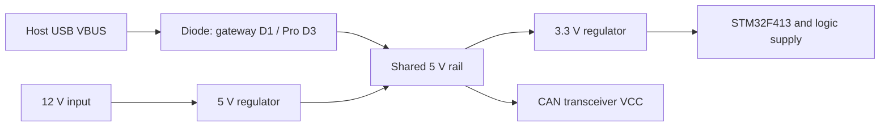

# Ocelot base power circuit — November 7, 2026

Owner clarification: **"see on ovelot foldeer the sch is same onli i/o is added"**.
Use the Ocelot drawings as Chimera's working base-circuit evidence with added I/O.
This corrects the earlier treatment of them as unrelated references and the
repeated request for an applicable power schematic. It does not establish measured
current, every added-I/O route, or installed bootstub/recovery state.

The source audit is complete:17gateway nets were checked against the board's
physical pad connections, then the Pro's power/USB paths and nine CAN signal pins
were traced and compared.36source checks pass. Firmware was not changed by this
audit. [Extracted data/source hashes](../hardware/ocelot-base-power-20261107.json)
and [replay/report](../../Ai/Reports/chimera-power-schematic-20261107/README.md).

## Power and USB connections

This is the drawn topology, not a measured isolation/current/suspend result.
The diode is BAS40. The regulators are labelled MIC5233-5.0 and MIC5233-3.3.
The gateway uses PS1/IC1 and the Pro uses PS1/PS2. USB and external input feed a
shared rail, so MCU/rail power alone cannot identify whether host VBUS is present.
A diode direction in a drawing does not qualify regulator reverse-current paths,
voltage drop, available load current or behavior of the assembled board.

| Connection | Gateway source and matching board | Pro source and original PDF |
| --- | --- | --- |
| Host VBUS | J1.VBUS -> N$5 -> D1.A; no MCU on this net | Both USB1.VBUS pins -> D3.A; no MCU on this net |
| Diode output | D1.C ->5V, also PS1.OUT and IC1.IN/EN | D3.K ->5V, also PS1.OUT and PS2.IN/EN |
| MCU PA9, pad42 | No schematic net and no board signal/contactref | Named PA9 net to header H5 pin9; not VBUS |
| USB data | PA11/pad44 through R2; PA12/pad45 through R1 | PA11 through R8; PA12 through R7 |
| Three CAN RX/TX/enable groups | PB8/PB9/PC1; PB5/PB6/PC13; PA8/PA15/PA0 | Same nine MCU pins |

**Neither base drawing supplies a VBUS-sense connection to the MCU.** The extra
I/O must not be assumed to add one. The firmware common initializer configures
PA9/PA10 as USART1. PC2/PC3 are Chimera's retained analog inputs; do not repurpose
them using the generic Panda voltage-sense comment. USB Type-B on Chimera versus
USB-C on these references is another reason to retain Chimera's connector map.

The nine CAN pins match; that does not make every output interchangeable.
Gateway PWRON uses PB12, Pro IGN_SIM uses PA1, while Chimera's onboard relay is PB0.
Keep the existing Chimera relay/OBD-C/direct-input mapping instead of copying the
base board's extra controls.

## Why the old firmware can use USB

The selected F413 build defines STM32F4. Its original USB initializer sets
BVALOEN and BVALOVAL in GOTGCTL, while its VBDEN enable line is commented out.
Thus it forces the controller's B-session-valid state in software; it does not
measure cable voltage. Its raw descriptor power bytes are0xc0/0x32. These are
historical declarations, not consumption measurements or a selected new profile.
The drawing and source explain the architecture; no current installed firmware
identity or physical behavior is inferred from them.

## Consequence for our new firmware

T03c3a's sensed-VBUS supervision works in its simulated tests. It cannot receive a
truthful PRESENT from an unmodified base circuit that has no detector. Do not add
a constant-PRESENT reader, silently call the shared5V rail host VBUS, or assume
that changing PA9's function creates a physical connection.

The next software slice should implement an **explicit legacy no-VBUS session
mode** derived from the original source, separate from a sensed mode. Keep it
opt-in and offline/default-held while its controller initialization, invariants,
reset/suspend/session-loss behavior and host lifecycle are tested. USB traffic or
control heartbeat can establish link/session activity; neither is a physical
VBUS measurement. Bulk CAN, operational health, MCU TX and physical release remain
separate. No legacy override has been enabled by this audit.

Actual attachment still needs a reviewed power profile, USB pin/timing setup,
packaging/current installed recovery and bench qualification. An added physical
sensor is an optional hardware design path, not a newly imposed requirement for
researching compatibility with the owner's existing board.

## Evidence limits and progress

Gateway XML pin/net/device-pad data agrees with17board signal/contactref sets.
Pro ASCII extraction uses a0.1schematic-unit grid to accommodate fractional export
offsets and was visually checked against the original owner-supplied PDF. This
is selected-path evidence, not a native EDA/ERC or complete Chimera equivalence
check. Source/working-file hashes and the preserved dirty Ocelot state are recorded.

**This source-audit stage(T01b):100% complete. Overall planning estimate:about25%
complete/75% remaining. New-firmware hardware validation:0%.** All25firmware build
inputs and the unsigned8108-byte image remain unchanged. The33firmware tests
passed at4b6098789; no fresh firmware test run is claimed for this documentation/
source-audit stage. Source replay, preservation and notebook checks were run.
[Receipt](../../Ai/Evidence/chimera-base-power-20261107.json).
