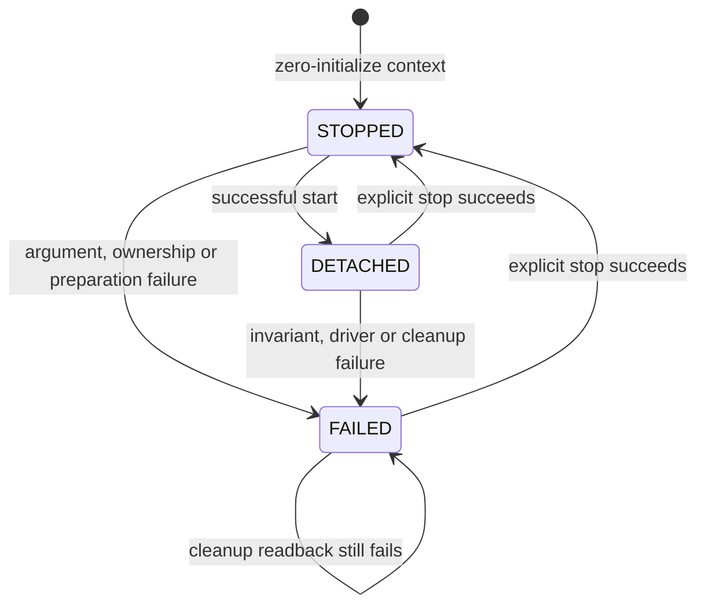

# Detached USB startup/service composition

November7 T03c1 update: main now calls the boot-facts reader through checked
preparation, but still does not instantiate/call this service. MMIO binding was
split from DWT initialization so the snapshot has no new peripheral-write side
effects. Current raw7592bytes/globals32bytes/30tests; historical service checkpoint
below remains source-pinned. [Main startup](MAIN_STARTUP.md).

November 6, 2026 — T03b3b implemented offline. The new
[usb_service.c](../firmware/usb_service.c) composes the existing boot-facts,
timing, USB clock/core and EP0 packet libraries. No service is instantiated or
called by main, no GPIO/IRQ is enabled and no USB attachment API is added.

In plain language: the earlier pieces now have one coordinated preparation,
polling and shutdown path. This library can prepare the controller while keeping
it invisible to the host. It does not establish an operational board connection.

## Lifecycle and ownership

Caller must zero-initialize the context, keep its address stable and serialize
all calls. Never copy/move/reset a live context. IO method pointers are copied
into the context; the driver's IO pointer refers to that owned copy. Callback
context remains caller-owned, trusted and alive; input objects must not alias
service state. State/error enums are local diagnostics, not USB status ABI.

The caller owns a quiet board, main PLL/affected clock domain and USB exclusively;
HSI/HCLK starts at nominal16MHz with USB gated. The service does not establish
GPIO/transceiver/relay levels or inspect unrelated peripheral ownership. An
unowned/active USB controller or wrong clock profile is rejected before writes.
The existing ARM MMIO factory remains the platform adapter. It initializes DWT;
service start rechecks timing without resetting the cycle counter. No additional
MMIO factory or platform startup hook is introduced here.

Start performs this sequence:

1. Validate callbacks, profile ranges and read budgets; reject non-STOPPED state.
2. Check HSI/AHB, no HSE bypass and gated USB ownership before modifying registers.
3. Read and validate UID/raw reset/options; facts_valid means that snapshot passed,
   not that a watchdog is stopped or the board is qualified.
4. Enable/check DWT timing, then take ownership for USB48 preparation.
5. Prepare clock and detached core; initialize EP0 driver from captured UID.
6. Verify soft-disconnect, global IRQ/DMA off, no forced session-valid override,
   PHY on and fixed CPU clock profile; only then enter DETACHED.

The supplied self-powered/current parameters are validated as descriptor values,
not approved as a physical power profile. Synthetic fixtures use both profiles;
neither is selected for the owner's board or passed from main. No attachment is
possible through this module. Existing phase0 capability/layout fields remain0.

## Polling and release

Poll accepts1..32events and keeps the existing driver's idle/progress/budget
semantics. Invalid phase/budget does no I/O. Detached invariants are checked before
and after the driver call. An unexpected connection, IRQ/DMA enable, session
override, PHY/CPU-clock change, clock/reset ownership loss or driver error latches
FAILED and disables further polling. There is no automatic retry/recovery loop.

Failure and explicit stop invalidate pending driver/model work. If owned core
registers are accessible, release writes SDIS, masks interrupts and powers down
the PHY. It then holds peripheral reset and gates the USB clock, preserving other
RCC bits. Readbacks must confirm reset held and clock gated before ownership is
released. An inaccessible gated/reset core is never accessed as a USB register.
No USB hardware is touched when start never acquired it.

cleanup_ok reports the cleanup result, not electrical cutoff qualification. If
readbacks fail, ownership/error remain latched and explicit stop may be retried.
A successful stop is required before another start; repeated start cannot replace
a live or failed context. Already STOPPED is an I/O-free no-op. The code does not
restore PLL/HSE/debug settings or alter SYSCLK, watchdogs, option bytes, flash,
settings, CAN or board GPIO. Exclusive clock ownership is a prerequisite.

Counter/read/event budgets are not elapsed deadlines. Scheduler latency, inherited
watchdogs, suspend/resume, VBUS/session handling, reconnect and actual electrical
state remain unqualified. No raw UID/reset snapshot constitutes attestation.

## Actual verification and next step

23offline tests pass. The new ASan/UBSan fixture runs the real composed C modules
against a register backend, not success stubs.44scenarios cover initial success,
UID/timing/PLL/clock/reset/core/driver failures, ownership/profile rejection,
pre/post-poll invariant faults, failed cleanup/readback and explicit recovery,
copied IO lifetime, stop/restart, event budget and invalid arguments. Write
whitelists exclude GPIO/CAN/watchdog/flash/config/UID writes; controller access
requires enabled clock/released reset and every DCTL write retains SDIS.

A failing clock-drift test led to checking the CPU profile on poll boundaries.
An initial fixture classified Cortex debug addresses as USB due to an overly
broad address comparison; corrected the test's peripheral range. No production
check or test was skipped/weakened. All prior clock/EP0/FIFO/CAN/boot-facts,
sanitizer, copied-tree, negative image and ARM artifact checks pass. ARM symbols
are retained, and disassembly confirms no service call in chimera_reset.

Raw7448bytes, projected legacy7584/114688bytes, globals8bytes/stack4096unchanged.
[Exact receipt](../../Ai/Evidence/chimera-usb-service-20261106.json) pins final
source/test hashes, actual output, build/tools and preserved original sources.
The same source contracts and pinned ST/Ocelot evidence from
[the packet driver](USB_PACKET_DRIVER.md) and
[startup requirements](USB_STARTUP_REQUIREMENTS.md) apply. This is composition of
reviewed libraries, not a new manual/compliance or REA/runtime result.

T03b3b is complete as an unbound detached service. Full T03 startup/attachment is
still partial. Next board slice is T05a: exact status/capability semantics and
offline response fixtures before exposing operational health; bulk CAN/controller
binding follows. Host legacy health decoding/managed lifecycle remain separate
pending work. Actual attachment still needs the power/VBUS/current-recovery
evidence, and inputs/Core Config/MCU TX policy remain unfinished. No device,
flash/reset, relay/config/DBC write, install, upstream update or push occurred.
