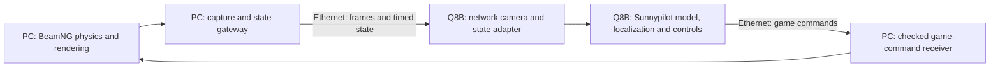

# BeamNG.drive with Sunnypilot on Radxa Q8B

Source review, 2026-11-02. This describes the reference and proposed integration;
**a BeamNG backend has not been added or run in this Sunnypilot checkout.**
The existing camera/CD210 GPU preview remains the selected working bench path.
The rejected W8A8 NPU candidate is not part of this simulator plan.

## Repository found

[Caleb-J773/beampilot-drive](https://github.com/Caleb-J773/beampilot-drive)
replaces openpilot's camera and car connection with a BeamNG window capture and
vehicle Lua mod. It targets the consumer Steam BeamNG.drive on Linux, using
screen capture/custom protocols rather than the licensed BeamNG.tech camera.
Its upstream author reports steering, speed holding, traffic braking and lane
changes. Those are author reports, not tests on our Q8B.

Fresh GitHub check: `master` remains
`5435d67499f66eca58f95882cbe35e9c577e874c` (2026-09-14), the same pin teacher
reviewed on2026-10-28. README says development moved to
[steerpilot](https://github.com/Caleb-J773/steerpilot), but both the public
GitHub API and public page return404 on this check. This does not establish
whether the successor was deleted, renamed or made private. Use the accessible
pinned source for research. Do not describe the archive as actively updated.
The original ko6lvm/beampilot is earlier architectural work; Caleb's README
explains that its camera/vehicle daemons were stubs there.

| Reference component | What it does |
| --- | --- |
| [`beamcamd.py`](https://github.com/Caleb-J773/beampilot-drive/blob/5435d67499f66eca58f95882cbe35e9c577e874c/openpilot/selfdrive/beamcamd/beamcamd.py) | Captures the local game window, converts to padded NV12, publishes VisionIPC and camera messages; configured20Hz. |
| [`beamngd.py`](https://github.com/Caleb-J773/beampilot-drive/blob/5435d67499f66eca58f95882cbe35e9c577e874c/openpilot/selfdrive/beamngd/beamngd.py) | Receives vehicle telemetry, synthesizes Honda CAN/sensors and translates openpilot curvature/acceleration into game commands; configured100Hz. |
| [`beampilot.lua`](https://github.com/Caleb-J773/beampilot-drive/blob/5435d67499f66eca58f95882cbe35e9c577e874c/tools/beamng_mod/beampilot_bridge/lua/vehicle/protocols/beampilot.lua) | Sends vehicle state over UDP49152; receives steering/throttle/brake on PC loopback49153 and applies game inputs. |
| [`openpilot_cam`](https://github.com/Caleb-J773/beampilot-drive/tree/5435d67499f66eca58f95882cbe35e9c577e874c/tools/beamng_mod/openpilot_cam) | Dedicated rigid game camera with known pose/FOV, distinct from a freely moved player camera. |

## Where our existing sim code lives

The actual path is **`openpilot/tools/sim/`**. The root `tools/` directory holds
project setup/Q8B helpers; it currently has no `sim/` child.

- [run_bridge.py](run_bridge.py) imports and creates `MetaDriveBridge` only.
- [bridge/common.py](bridge/common.py) owns the generic simulator loop.
- [lib/camerad.py](lib/camerad.py) publishes simulated camera images.
- [lib/simulated_car.py](lib/simulated_car.py) publishes fake Honda CAN/panda.
- [lib/simulated_sensors.py](lib/simulated_sensors.py) publishes simulator IMU,
  GPS, peripheral and driver-monitoring fixture messages.
- [launch_openpilot.sh](launch_openpilot.sh) selects a simulator process setup.

These pieces are useful integration boundaries, but running the current
`run_bridge.py` starts MetaDrive, not BeamNG.

## Our PC plus Q8B design

The reference is principally same-host. Copying `beamcamd` onto Q8B would
capture Q8B's desktop instead of the PC game. Its game-control receiver is
bound to127.0.0.1, so setting a remote IP alone does not create this bridge.
Reuse teacher's existing PC-to-Q8B camera/state transport evidence; keep the
PC-local game listener behind a PC gateway.

Concrete compatibility gaps in the inspected source:

1. **Camera contract:** our current Thneed adapter requires1280x720 and explicit
   Q8B road-only mode; sim helpers/reference beamcamd use1928x1208. Adapt the
   network producer and gate it explicitly rather than dropping in that source.
   Match the game render FOV, crop and mount to its actual input intrinsics.
   The AK-Camera's borrowed MM-X focal900 profile is not a BeamNG calibration.
2. **State API:** external `beamngd` calls `SimulatedSensors(create_camera=False)`;
   our constructor only accepts `dual_camera`. Vehicle/Cereal/opendbc contracts
   need adaptation. Fake Honda sim CAN stays inside simulation; it does not
   replace canonical RetroPilot hardware DBC or imply physical CAN output.
3. **Timing/freshness:** source BPL1 lacks session/sequence/source timestamps.
   Its telemetry loop can retain old state while continuing to send controls.
   Lua's0.5s command-silence watchdog does not detect continually refreshed
   commands computed from stale telemetry. Network camera/state/commands need
   explicit session identity, timestamps, freshness, ordering and disconnect
   handling on both hosts. Account for clock offset uncertainty across hosts.
4. **Geometry and control:** steering input, steering-wheel angle, road-wheel
   angle, yaw rate and curvature have different units. Match the actual spawned
   car and compare requested/achieved curvature before closing a lateral loop.
   Do not import this fork's driving-limit/alert changes wholesale.

## First implementation slice

1. Bring PC game frames into a dedicated Q8B sim-only VisionIPC producer and
   show them in our existing Sunnypilot UI. Preserve source IDs/times and padded
   NV12 layout; verify advancing unique frames, stale detection and no webcam
   producer collision. Use a recorded-frame fixture before a live game check.
2. Add measured speed, four-wheel/steering/pedal/gear/cruise and motion state;
   validate axes/units, rates, timestamps, pause/disconnect/restart behavior.
3. Run Sunnypilot localization/planning/control in shadow and inspect outputs.
4. Then enable explicit game-only lateral feedback with limits, operator stop
   and independently enforced stale/disconnect handling at the PC gateway.

No mod installation, game start, manager launch or game control was performed
by this research task. Previous BFR2 delivery and CPU ONNX game control were
separate tests, not this managed integration. The former BFR2 receiver discards
pixels; transport success alone does not connect VisionIPC/modeld. No physical
vehicle interface is involved in this proposed simulation path.

[Source/hash receipt](../../../Ai/Evidence/beamng-reference-20261102.json) ·
[Student notes](../../../Ai/Knowledge/BEAMNG_BRIDGE.md).
