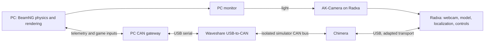

# BeamNG optical camera and CAN hardware-in-the-loop project

Owner-selected architecture, 2026-11-03. This folder separates the **PC** and
**Radxa** work for our Sunnypilot port. The layout and requirements are saved;
the CAN bridge and Chimera backend are **not implemented or tested yet**.

The PC renders BeamNG on its monitor. The existing AK-Camera, plugged into
Radxa, points at that monitor. Simulated vehicle state and returning controls
travel over physical CAN through Waveshare and Chimera. This supersedes the
earlier proposal to send PC camera frames over Ethernet.

Chimera fills the Panda interface role. It does not run the driving model.
The PC gateway translates BeamNG state into the agreed CAN contract and
translates accepted returning CAN commands into game inputs. It must consume
the final car-controller commands so the controller is included in the test.

## Folder ownership

| Folder/document | Responsibility |
| --- | --- |
| [pc/](pc/README.md) | BeamNG telemetry/game-input adapter and Waveshare gateway requirements; future PC source belongs here. |
| [radxa/](radxa/README.md) | Existing webcam/model path, Chimera transport and Sunnypilot car-port requirements; future Radxa adapter source belongs here. |
| [shared/CAN_CONTRACT.md](shared/CAN_CONTRACT.md) | Shared DBC pin, signals, routing, freshness and protocol gaps. No private replacement DBC. |
| [PLAN.md](PLAN.md) | Ordered implementation increments and evidence required for each. |
| [../beamng_reference/](../beamng_reference/README.md) | Immutable downloaded source and its audit, used selectively during adaptation. |

All active source will live in this Sunnypilot repository. `pc/` is the source
to deploy to the game PC; creating this directory does not copy it to that
machine. No remote installation, game launch or hardware transmission was done.

## Two stages

**First: optical + CAN simulator loop.** BeamNG supplies steering-wheel angle,
vehicle speed, four individual wheel speeds, motion/IMU, pedals, gear and
cruise/button state. Sunnypilot receives them through Chimera. Accepted
Sunnypilot commands return through CAN to control the simulated car. Engagement
and disengagement must be represented explicitly; cruise ON is not permission
to apply arbitrary commands. Driver monitoring remains deferred in the existing
explicit road-camera bench mode.

**Later: bench actuators.** Add the actual steering Interceptor/Core, angle
sensor and brake/accelerator endpoints after their protocols and calibration
are qualified. During the initial simulator loop those actuators are excluded
from the simulator bus. Sending their real command IDs on a shared live bench
bus could move them even if a software flag says “simulation”.

The later bench test needs a deliberate feedback choice: either BeamNG angle
remains authoritative and the bench follows it as a demonstration, or measured
bench angle drives BeamNG and provides the closed-loop steering feedback.
The first does not validate the bench steering plant. Do not publish both as
the same angle or turn on the bench before this choice is resolved.

## What this will test

The completed first stage will exercise the real camera, Q8B model/controls,
Waveshare CAN transport and Chimera USB path against a simulated vehicle.
It will not establish real-road calibration or vehicle suitability. Photographing
a monitor adds refresh/scanout, exposure and optical delay; game FOV alone is
not the AK-Camera's lens calibration. Save screen coverage, camera pose/focus,
game camera pose/FOV and measured sign/units with each run.

Current runtime remains the existing 1280×720 road webcam/CD210 GPU path.
There is no BeamNG launch command yet. Start with [the implementation plan](PLAN.md).
